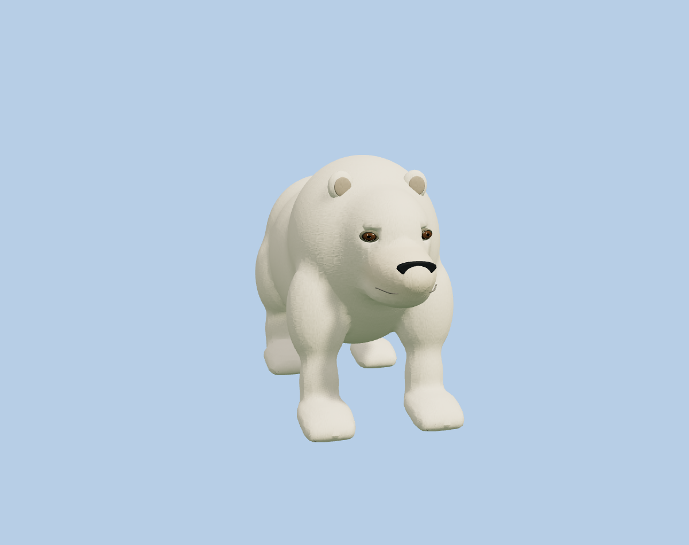
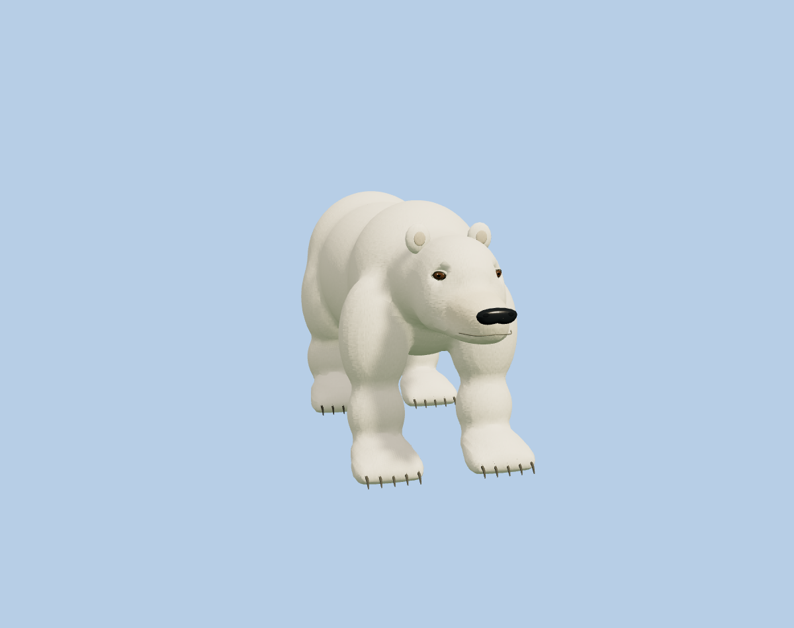
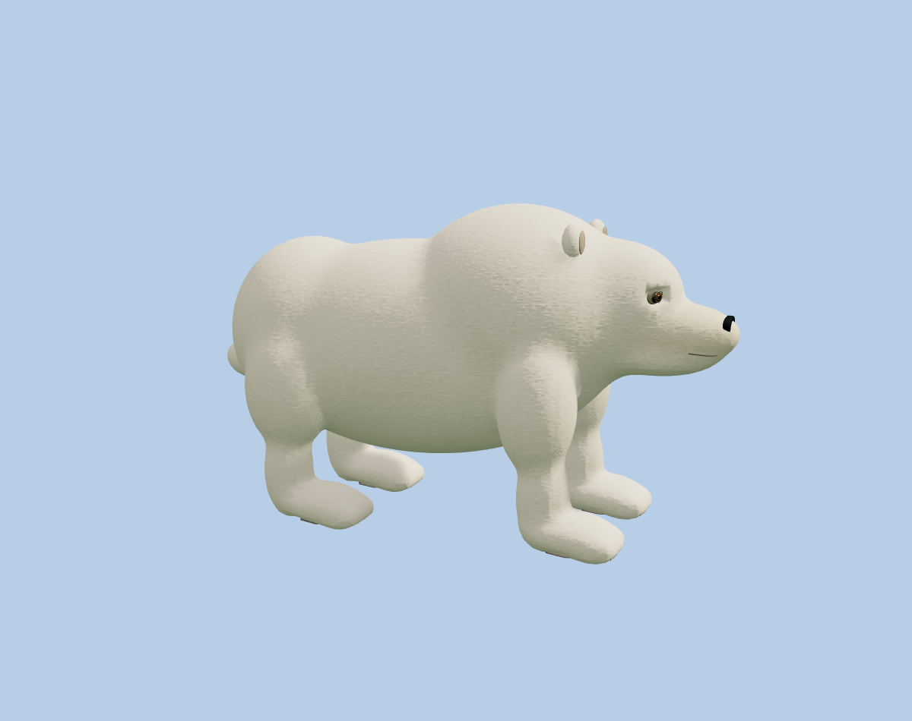
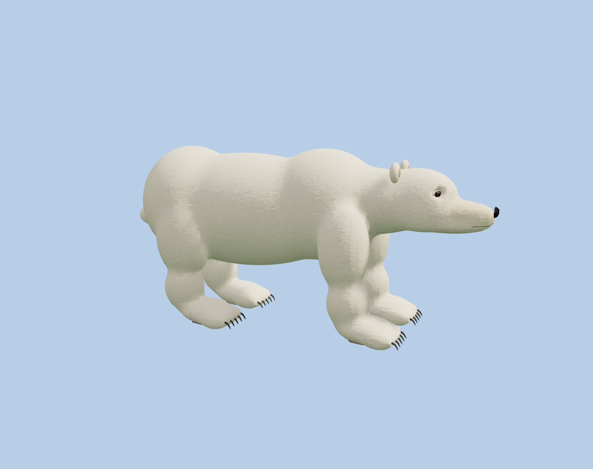

# Polar bear anatomy and actual ground movement

Compared with published dd25508 under the same lighting, camera and distance:

| | Before | After |
|---|---|---|
| Front |  |  |
| Side |  |  |

Longer low skull/neck, smaller shoulder and ears/eyes, convex wet nose, five
toes and curved claws. The lower leg now ends at the actual ankle instead of
extending through the foot during a crouch. Hair-card backs share an outward
normal rather than producing dark patches; the bear has eight varied tufts in
one static 256-square R8 atlas. The other furry species retain their geometry
and poses with this lighting correction; elephant and axolotl binaries are
byte-identical to the published version.

Walk, snow play, rest and swimming have separate authored choreography and
26/9/10/7/13-second action timing. Actual world-space planted feet, lifted toes,
snowball contact, resting soles and closed action endpoints are tested.

Mobile budget: 42,137 vertices / 53,136 triangles, down from 43,026 / 53,176.
Geometry buffers shrink 82,028 bytes; pose buffers stay 588,800 bytes. The new
shared atlas costs 65,536 bytes. No extra animal batches, instances, render
passes or per-frame geometry/pose uploads. These counts are not device FPS.

All 826 tests, production build and Worker dry-run passed. Real private native
phone-viewport/SQLite checks verify new downloaded polar-v5 assets, all six
cameras, visitor actions and two durable reloads. Saves, cat meshes, animal
counts, other islands, DPR and water are retained. The RDR 2 reference is an
anatomy/material direction, not a claim of equivalent AAA fidelity.
