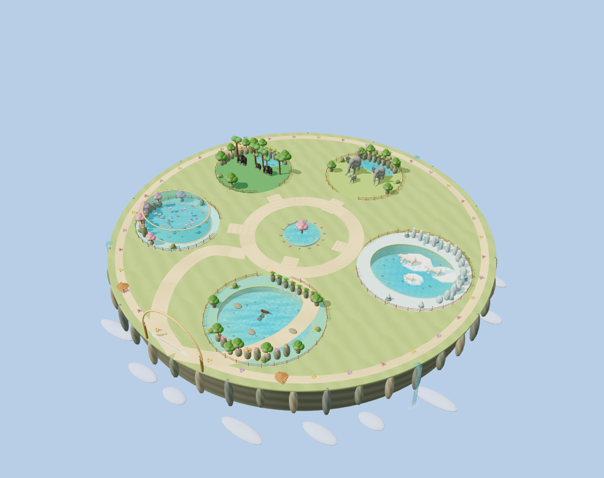
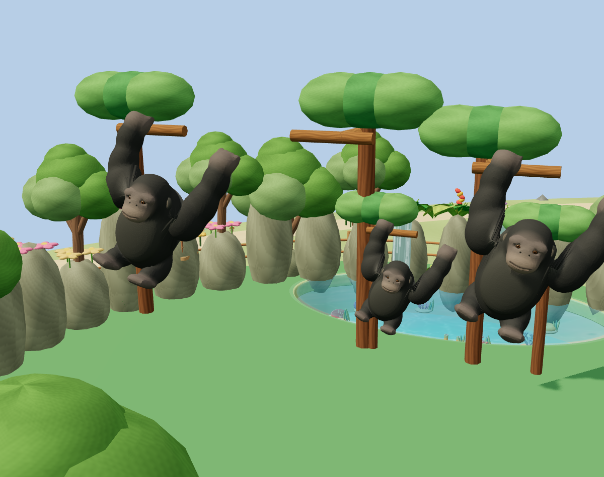
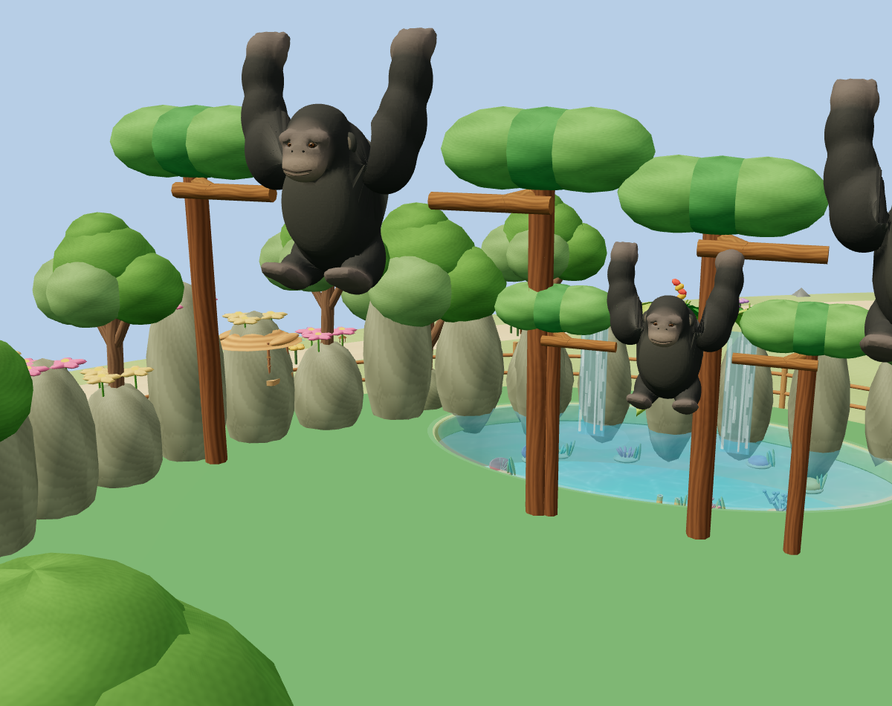
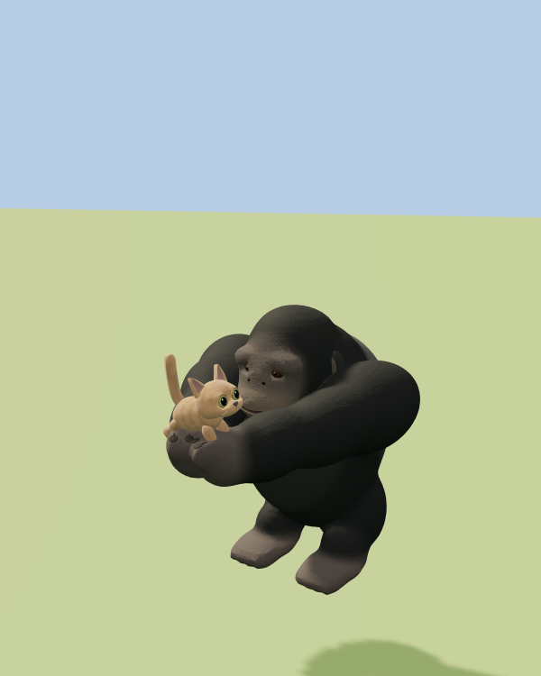

# Zoo expansion, animal play and cameras

Source: `eea035dd4795007572f4ed1c5e34e6b6c1559cb2`.

The zoo has exactly four times its released land area. All retained habitats
have at least four times their former area; otters and polar bears occupy the
retired tiger side. There are five habitats and 21 animals. The three tigers,
their gate, model asset, shop preview, activity and obstacle are removed at the
player's request. Historical paid tiger receipts remain valid and permanent;
new payments from cached old clients reject atomically. Other islands, roads,
owned placements, balances and the approved native cat cache are retained.

Gorillas beat their chests and dance/jump, approach the reserved public seat,
reach down with both arms, support the original cat rig, jump together on three
gravity arcs, put the cat down and return. One scene reserves the performer;
other gorillas can react independently. Actual palm queries determine cat
support, including tiny and giant breeds. Cancellation releases the reservation
and pose; carrying positions are transient in durable location snapshots.

Independent ambient branch swings pin a real palm to each actual tree branch,
launch through a gravity arc, catch the next branch and return to neutral ground.
Grip/release keys align with atlas rows. Branch positions/heights match each
instance's original size. Elephant spray, axolotl surface splashes, otter rolls
and bear paw greetings use distinct reactions and native cat play/photo poses.

Every open habitat has a fitted elevated front camera and a native random guest
camera. The guest list includes ordinary cats walking inside the zoo, excludes
remote actors, and needs no active attraction ride. Empty lists disable the
button. The native head camera handles tracking, zoom and return; the ordinary
attraction fit handles portrait/landscape enclosure framing.

Validation: 838 full-suite tests passed; targeted camera, play, expansion,
shared payments, purchase preservation and world-performance checks passed.
The native phone/SQLite audits verify all five enclosure and animal cameras,
real tiny/giant carry, actual guest head tracking, world/island camera returns,
paid gate receipts, and two reloads. Separate ownership recovery checks retain
Mega Loops and balances without another charge. See JSON reports beside this
file. Browser fixtures use isolated private saves, never a player world.

All retained animal vertex/triangle counts are unchanged. Elephant, axolotl and
otter asset bytes are identical to the preceding release. Polar changes only
its greeting skin targets; its refined `polar-v5` anatomy remains intact.
Gorillas add 96 baked rows (79,872 bytes) for approach/hold, without extra rigs or
per-frame geometry/instance uploads. Each species retains one animal batch.
Three bounded water batches use fixed 128-drop buffers and sleep when inactive.
The full island review has 131 calls / 2,774,579 triangles including shadows;
these are operation counts from software Chromium, not physical M2/iPhone FPS.
Native audits include continuous rendering and fixed-draw correctness runs;
the latter skip redundant background draws while checking each real GPU image.

Before expansion: [released zoo](../../2026-10-28/magic-zoo/models/island.png).

After expansion:

Real branch grip and transfer:

Real native kitten held during a shared jump:

